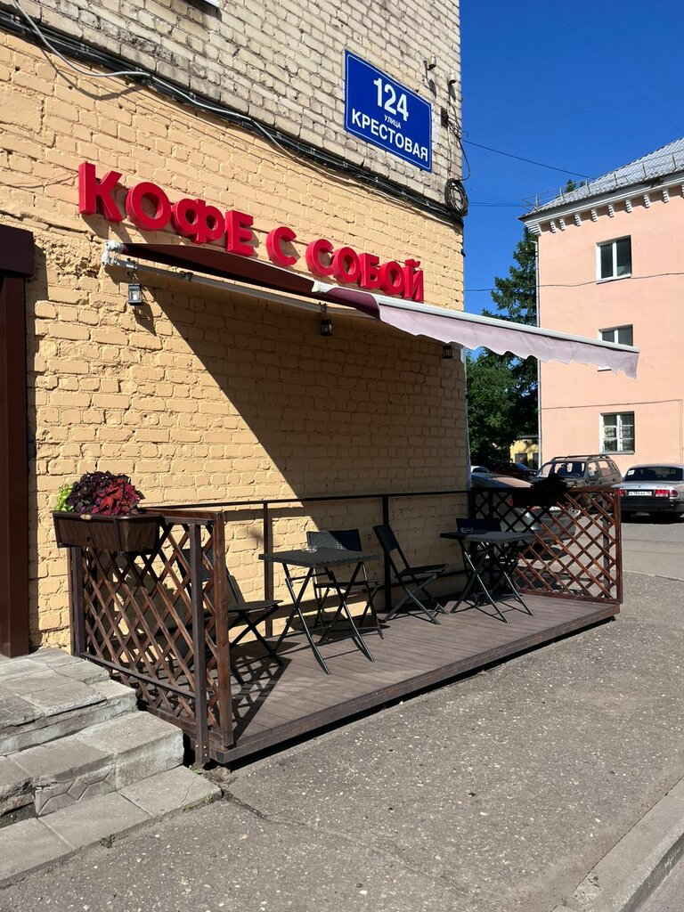

# eatmyskinn / Веб-портфолио

Адаптивные сайты для локального бизнеса: кофейни, кафе, гостиница и автомобильные сервисы. Визуальные концепции, фотографии реальных мест и интерактивные детали на HTML, CSS и JavaScript.

**[Открыть главную страницу — исходник](index.html)** · [Каталог проектов](PROJECTS.md) · [GitHub](https://github.com/eatmyskinn)

> Это демонстрационные концепты, а не выполненные коммерческие заказы. Информация о предприятиях собрана из открытых источников. Работа подготовлена с использованием AI-инструментов; объём личного вклада не заявляется без уточнения автора.

## Новые концепты · Екатеринбург

[Три новых сайта и исходники](ekb-business-demos-2026-11-17/) — Shinka Burnout, Тардис и сервисный центр в ТЦ «Омега». Фотографии сохранены локально, есть мобильные версии и анимации с поддержкой уменьшенного движения. [Описание проектов и проверки](ekb-business-demos-2026-11-17/README.md). Для просмотра скачайте файлы; постоянный хостинг по просьбе автора не настраивался.

## Избранные проекты

| Проект | Что посмотреть | Исходники |
|---|---|---|
| **Кофе с собой · Рыбинск** | Бордово-кремовая композиция, переключатели разделов, галерея и мобильная версия | [Открыть проект](dist/) |
| **Версаль · Верхние Киги** | Редакционная типографика, фотогалерея с переключением и контакты | [Открыть проект](versal/) |
| **Театральная кофейня · Челябинск** | Театральная палитра, CSS-декор и структура страницы заведения | [Открыть проект](business-demos-2026-11-14/theatre/) |
| **АвтоЛап · Верхняя Пышма** | Контрастный сайт автосервиса, услуги и прямые контакты | [Открыть проект](business-demos-2026-11-14/avtolap/) |

### Кофе с собой — Рыбинск


[HTML](dist/index.html) · [CSS](dist/style.css) · [JavaScript](dist/app.js) · [Проверка сведений](dist/verification.md)

## Что есть в проектах

- Адаптивная вёрстка и индивидуальная визуальная концепция.
- Галереи, переключатели и раскрывающиеся блоки — в зависимости от проекта.
- Поддержка предпочтения уменьшенной анимации в новых концептах.
- Контакты, маршруты и ссылки на источники вместо фиктивных форм отправки.
- В новых страницах фотографии встроены в HTML, чтобы не зависеть от путей к файлам.

## Запустить локально

Скачайте репозиторий и откройте `index.html` в браузере. Для HTTP-предпросмотра из корня:

```sh
python -m http.server 8000
```

Откройте `http://localhost:8000`. Сборка и установка зависимостей не нужны.

## Публикация

Репозиторий подготовлен для GitHub Pages: **Settings → Pages → Deploy from a branch → main → / (root)**.
После включения ожидаемый адрес: `https://eatmyskinn.github.io/site-s/`. Это инструкция, а не подтверждение работающей публикации.

## Данные и фотографии

Контакты и актуальность услуг перед официальной публикацией нужно подтвердить у владельцев. Фотографии из открытых карточек не означают разрешения на коммерческое использование. У «Как дома» найдена страница другого филиала на clients.site — сеть не заявляется как бизнес без сайта. У «Театральной кофейни» использован декоративный фон, а не фотография заведения.

## Контакт

[Профиль GitHub — eatmyskinn](https://github.com/eatmyskinn)
